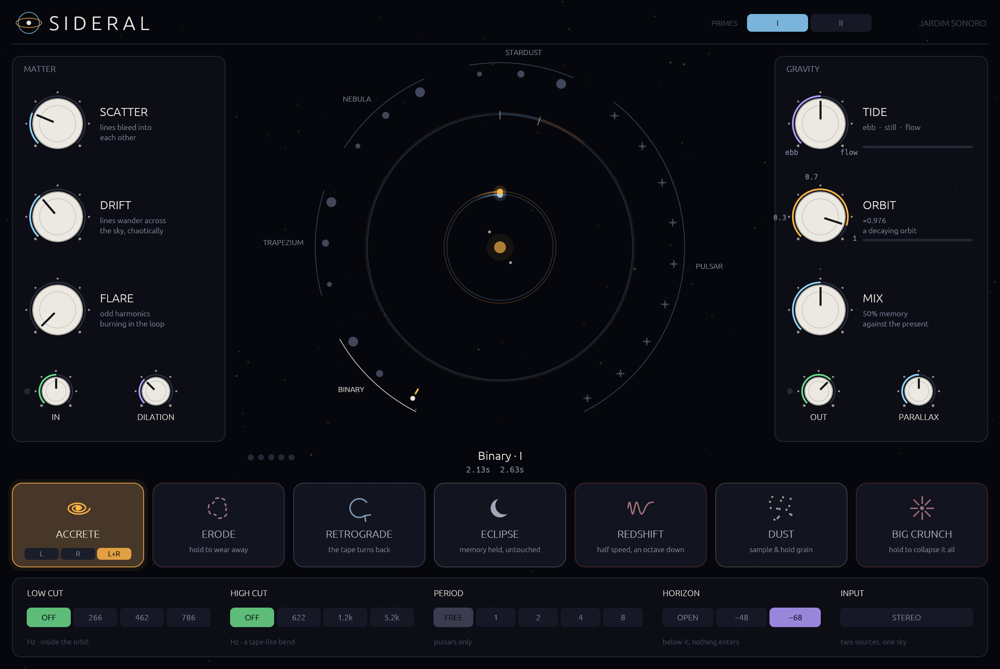

# Sideral

*A memory that drifts like the sky. Not to be confused with a looper, which it will find mildly insulting.*

AU · VST3 · CLAP · standalone — macOS (Apple Silicon), Windows, Linux.



---

## What is it, exactly?

Sideral is 44.7 seconds of sound memory with ideas above its station.

Whatever you feed it is written into a ring of delay lines whose lengths are all different
prime numbers of samples. Primes, being famously antisocial, refuse to line up. So the
echoes of your phrase slide past one another, pass, and drift apart again, and the phrase is
never heard the same way twice. Slow tides carry the lines from one speaker to the other;
the tides themselves are stirred by a random walk nobody quite controls. The result is
music that keeps changing its mind, the way the night sky does if you stand in a field long
enough and are a little cold.

It is very good at ambient, drones, guitar-and-weather, voice pieces, slow electroacoustic
work, and evenings when you had planned to go to bed early.

It is not good at being told what to do. This is by design.

---

## Installing

Fetch the archive for your system from
[**Releases**](https://github.com/nagualcode/sideral/releases/latest).

**macOS (Apple Silicon)** — unzip and run `install.sh`, or copy by hand:

| File | Goes to |
|---|---|
| `Sideral.component` | `~/Library/Audio/Plug-Ins/Components/` |
| `Sideral.vst3` | `~/Library/Audio/Plug-Ins/VST3/` |
| `Sideral.clap` | `~/Library/Audio/Plug-Ins/CLAP/` |

If macOS refuses to open it on the grounds that it came from the internet (it did), run
`xattr -cr ~/Library/Audio/Plug-Ins/Components/Sideral.component` and so on, then restart
your DAW. Ableton Live users: rescan, and look under *Audio Units → Jardim Sonoro*.

**Windows** — copy `Sideral.vst3` to `C:\Program Files\Common Files\VST3\` and/or
`Sideral.clap` to `C:\Program Files\Common Files\CLAP\`.

**Linux** — copy `Sideral.vst3` to `~/.vst3/` and/or `Sideral.clap` to `~/.clap/`.

There is also a standalone application in each archive, for those who prefer their
astronomy without a host.

---

## First light (in five minutes)

1. Put Sideral on a track with a sound source: a guitar, a voice, a synth, a kettle.
2. Leave it on **Binary · I**, the program at the bottom left of the dial. Set **MIX** to
   about half and **ORBIT** to about three-quarters.
3. Play a short phrase and stop. Wait. It returns about two seconds later, from the left, and
   again slightly later from the right.
4. Play another phrase over the first. Notice that the two never quite meet the same way
   twice. This is the whole point, and also the whole plot.
5. Now press **ECLIPSE**. The memory freezes, exactly as it is, and you can play over it for
   as long as you like. Press it again and the sky resumes turning.

Congratulations. You have observed your first sidereal event. Make a note in your logbook.

---

## The sky, explained

### The orrery

The large circle in the middle is not decoration, or not only.

- The **outer ring** is the entire memory, all 44.7 seconds of it, coloured by how the current
  program has carved it up. Grey regions are memory the program isn't using but hasn't
  forgotten either.
- Each **orbit** inside is a delay line. Its **planet** is the write head. The longer the
  line, the wider the orbit.
- The **sun** in the middle glows with whatever you are playing into it.

Watch the planets for long enough and you will see that they never line up again.

### The twenty-one programs, in five constellations

Click a point on the dial, or drag around the outer sky to sweep. A newly chosen program
takes about a second to arrive: Sideral fades out, re-slices the memory, and fades back in.
Celestial bodies do not hurry, and nor should you.

| Constellation | What lives there | Try it for |
|---|---|---|
| **Binary** I · II · III | Two delay lines, about 2, 10 and 22 seconds long | Frippertronic guitar, long drones, vocal layers |
| **Trapezium** I · II · III | Four lines feeding each other in a ring | Polyrhythms, percussion, anything that likes company |
| **Nebula** I · II · III | A reverberation the size of a small county | Distances you cannot drive to |
| **Stardust** I · II · III | Grains, scattered and drifting | Textures, clouds, fog from a single note |
| **Pulsar** | Nine loopers that keep time, more or less (see below) | Rhythm, beats, controlled disasters |

Changing program does **not** erase anything. The new program simply reads the same memory
through a different shaped telescope. This is how a reverb tail becomes a granular cloud
becomes a loop, without your consent and quite beautifully.

### The Pulsars

The Pulsar constellation is for when you want the sky to keep a beat.

- **Pulsar** — a straightforward loop. Press **ACCRETE** to start recording and press it
  again to close the orbit. The loop is exactly as long as you let it run.
- **Resonance 8:7** and **4:3** — the right channel loops a little sooner than the left.
  The bar stays put while the two halves slide gently out of phase, like moons in an
  orbital resonance.
- **Roche ÷8 · ÷6 · ÷5** — the loop is torn into slices, and each slice plays (and is
  rewritten into) a randomly chosen other slice. Over a few passes the loop rearranges
  itself permanently. The thin thread on the orrery connects where you are to where the
  sound is actually coming from.
- **Supernova ÷8 · ÷6** — Roche after a bad night. Stutters, ratchets that speed up,
  reversals, octave leaps, drop-outs and swells. The ring flashes when something goes off.
- **Kepler** — the loop is read at double or half speed and written back where it was read,
  so the transposition piles up on every pass. With **DRIFT** fully up, a single note becomes
  an accelerating cascade of echoes, an octave higher each time. Kepler would have been
  delighted. His landlady less so.

**PERIOD** (in the strip at the bottom) locks the Pulsar loop to 1, 2, 4 or 8 bars of your
DAW's tempo. Press play and the loop snaps to the bar. Leave it on **FREE** to set the length
by hand.

---

## The controls

### MATTER (left)

| Control | What it does |
|---|---|
| **SCATTER** | Lets the lines bleed into one another. In Stardust it scatters the grains; in the Pulsars it adds the *Halo*, a small, shimmering plate reverb. In the Nebula it has nothing to do and enjoys the rest. |
| **DRIFT** | Moves the lines across the stereo field on slow, chaotic tides. In Stardust it moves the grains. In Kepler it chooses the octave (low = down, middle = still, high = up). In Supernova, past noon, it permits random octave falls. |
| **FLARE** | Odd harmonics, burning inside the loop. A little warms things; a lot sets them alight. |
| **IN** | Input level. The little light goes green when there is enough, red when there is too much. |
| **DILATION** | The speed of time itself, from ×½ to ×2. Everything slows down or speeds up together: echoes, pitch, grains. Relativity, but with a knob. |

### GRAVITY (right)

| Control | What it does |
|---|---|
| **TIDE** | Left of centre (*ebb*): each new sound washes the old away, then lets it return. Right of centre (*flow*): a compressor that lifts the quiet and settles the loud. Centre: nothing, which is also nice. |
| **ORBIT** | How much of the memory survives each pass. The readout shows the loop gain: below ×1.000 the orbit decays, at ×1.000 it holds forever, above it things begin to grow. A soft limiter catches them before the neighbours complain. |
| **MIX** | Memory against the present moment. |
| **OUT** | Output level. |
| **PARALLAX** | Stereo width, from a single point to wider than your speakers. |

### The pads

| Pad | What it does |
|---|---|
| **ACCRETE** | Record. Choose **L**, **R** or **L+R**: which side of the sky receives new matter. Turn it off to play freely over what is already there. |
| **ERODE** | Hold to wear away what is currently playing. Release to stop eroding. Geology, in your hands. |
| **RETROGRADE** | The tape turns around. Everything plays backwards, including whatever you play next. |
| **ECLIPSE** | Freezes the memory, bit for bit. Nothing is written while it is on; play over it freely. |
| **REDSHIFT** | Half speed, an octave down, with a lovely rough edge. Binary, Trapezium and Pulsar only. |
| **DUST** | Switches the conversion to sample-and-hold. Grainy, aliased, slightly radioactive. Pairs well with DILATION below ×1. |
| **BIG CRUNCH** | Hold for just under a second to collapse the entire memory into silence. There is no undo. There never is, with a Big Crunch. |

### The strip

| Control | What it does |
|---|---|
| **LOW CUT** / **HIGH CUT** | Filters *inside* the loop, so each pass gets thinner or darker. The high cut bends like old tape. |
| **PERIOD** | Locks Pulsar loops to the host's bars. |
| **HORIZON** | A noise gate. Below it, nothing enters the memory. *Open* lets everything in; −68 dB is polite; −48 dB is strict. |
| **INPUT** | *Stereo*, or *Summed* to feed two different mono sources into the same sky. |

At the top right, **PRIMES I / II** chooses between two sets of prime numbers. Put one
instance on **I** feeding your front speakers and another on **II** feeding the rear, give
them the same input, and you have quadraphony that never repeats itself.

Every pad and knob can be automated from your DAW. This is how you perform an eclipse at
precisely 3:42.

---

## Observations (recipes)

- **Weather report.** Binary · III, ORBIT just under 1, DRIFT high, SCATTER a third.
  Play one chord every minute. Read a book.
- **The long corridor.** Nebula · III, ORBIT three-quarters, LOW CUT on. Clap once. Wait
  for it to come back from somewhere near Swindon.
- **Totality.** Build a texture on any program, then press ECLIPSE and improvise over it.
  Release it in the last bar.
- **Glitch for the well-adjusted.** Pulsar, PERIOD at 2 bars, record a beat. Switch to
  Roche ÷8. Switch back to Pulsar when the band looks worried.
- **Harmonices Mundi.** Kepler, DRIFT all the way up, SCATTER a third. Play a single note.
- **Lunar tape.** Binary · II, DILATION ×0.5, DUST on, REDSHIFT on. Play anything at all.

There are fifteen factory presets that come with the plug-in, under the same sort of names.

---

## Questions occasionally asked

**Why does a new program take a second to arrive?**
It waits for you to stop turning the dial, then fades out, re-slices the memory and fades
back in. The tiny soft gaps you sometimes hear are where the memory was glued back together.
They are part of the sound. Think of them as craters.

**Why is there latency?**
Sideral runs its own clock and translates between its time and yours. That costs about three
milliseconds, which it reports to your DAW so the DAW can compensate. Most people never
notice. Astronomers do, but astronomers notice everything.

**Is the memory saved with my project?**
No. Like the night sky, it is different every time you look. Bounce what you love.

**Can it loop like a normal looper?**
Pulsar, PERIOD on FREE, ORBIT at ×1.000. But please don't tell the others.

**Something escaped and it's getting louder.**
ORBIT is above ×1.000. Turn it down a whisker, or hold ERODE, or, in extremis, BIG CRUNCH.

---

## Building from source

```sh
cargo install cargo-truce
cargo truce install --au2          # or --vst3, --clap
cargo test --release --lib
cargo run --release --bin sideral-render -- out.wav program=13 fb=0.95 blur=0.4
```

Built in Rust with [truce](https://github.com/truce-audio/truce). One instance uses about one
per cent of a modern core. It passes `auval` and pluginval at strictness 8.

---

## Licence

GPL-3.0-or-later. See [LICENSE](LICENSE).

*Jardim Sonoro · Rio de Janeiro · 2026. Clear skies.*
